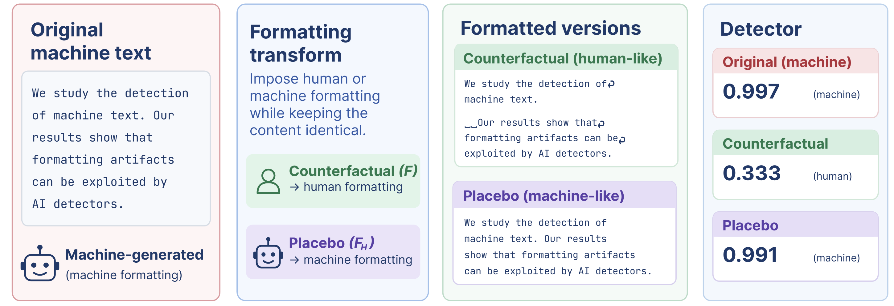

# Measuring Artifact Reliance in Machine-Generated Text Detectors
To appear in EMNLP 2026 DocInsights Workshop Prcoeedings

[](PAPER_PDF_LINK)
[](ARXIV_LINK)
[](LICENSE_LINK)

**Anastasia Voznyuk**¹ · **Andrey Grabovoy**²


---

## TL;DR

Detectors of machine-generated text score almost perfectly on scientific-literature benchmarks. On several of these benchmarks, that apparent ease is a side effect of how the documents were assembled, not of the detection problem itself.

- A logistic regression over **27 content-free surface features** reaches **0.833–0.997 macro-F1** across ten scientific-document subsets, and on the three arXiv subsets it **outperforms every detector we evaluate** (0.951–0.997).
- The strongest cue is a **PDF-extraction artifact**: human texts keep their original line breaks, machine texts come back from the API as a single block. Four formatting features alone separate the classes at **0.996 AUC**.
- We introduce **format counterfactuals** and the **Artifact Reliance Score (ARS)**: re-wrapping a machine-written abstract *without changing a single word* reverses **20–27%** of a public detector's correct decisions.
- **Artifact exploitability is tokenizer-dependent**: SentencePiece (DeBERTa-v3) discards the whitespace cue, byte-pair encoding (RoBERTa) keeps it. Scores on these benchmarks are not comparable across tokenizer families.
- **Normalizing formatting before training** reduces the generalization gap from 0.32 to 0.22 and raises out-of-domain macro-F₁ from **0.33 to 0.65** for arXiv-trained detectors evaluated on format-clean benchmarks.


## Overview

We audit ten scientific-document subsets drawn from six MGT-detection resources (M4, SemEval-2024 Task 8, COLING-2025 GenAI Task 1, IDMGSP, GPABench2, CHEAT) and ask two separate questions:

1. **Does the benchmark contain an exploitable artifact?** — answered by a cheap, content-free *surface probe* that never sees a word identity.
2. **Does a given detector actually rely on it?** — answered by *format counterfactuals*: admissible, word-preserving edits that move a document's formatting profile toward the other class, with a placebo control.

The two questions have different answers, and the gap between them is the point of the paper.

---

## Data

We do **not** redistribute the original benchmarks. Download each resource from its official source and point the scripts at it; we provide the isolation and reconstruction scripts for the corrected (format-normalized, deduplicated) subsets.

| Subset | Document type | \|H\| | \|M\| | Source |
|---|---|---:|---:|---|
| M4 arXiv | abstracts | 15,000 | 15,000 | [GitHub](https://github.com/mbzuai-nlp/M4/tree/main) |
| M4 PeerRead | peer reviews | 2,930 | 2,930 | [GitHub](https://github.com/mbzuai-nlp/M4/tree/main) |
| SemEval24 arXiv | abstracts | 15,498 | 11,999 | Currently not available |
| SemEval24 PeerRead | peer reviews | 2,357 | 9,374 | Currently not available |
| COLING25 arXiv | abstracts | 22,484 | 30,684 | [GitHub](https://github.com/mbzuai-nlp/COLING-2025-Workshop-on-MGT-Detection-Task1/tree/main) |
| COLING25 PeerRead | peer reviews | 3,300 | 16,169 | [GitHub](https://github.com/mbzuai-nlp/COLING-2025-Workshop-on-MGT-Detection-Task1/tree/main) |
| IDMGSP | paper introductions | 8,000 | 8,000 | [HuggingFace](https://huggingface.co/datasets/tum-nlp/IDMGSP) |
| GPABench2 CS | abstracts | 50,000 | 200,000 | [GitHub](https://github.com/liuzey/CheckGPT-v2) |
| GPABench2 Physics | abstracts | 50,000 | 200,000 | [GitHub](https://github.com/liuzey/CheckGPT-v2) |
| CHEAT | abstracts (IEEE) | 15,395 | 15,395 | [GitHub](https://github.com/botianzhe/CHEAT) |

All subsets are English; all machine documents are generated from scratch (no rewriting/polishing regimes). Selection criteria and per-subset isolation details are in Appendix C of the paper.

To build the corrected subsets:

```bash
python src/build_subsets.py --source-dir data/raw --out-dir data/subsets
```
---

## Recommendations for Benchmark Authors

1. **Normalize human documents to the same surface form as generations before release.** The arXiv artifact comes from document processing, which makes it cheap to prevent.
2. **Ship the surface-probe score and per-feature AUCs with the resource.** A content-free probe run at release time flags the subsets on which a deployed detector will later prove format-dependent (Spearman ρ = 0.94 with ARS_net).
3. **Document which tokenizer families a benchmark advantages.** The same resource can be trivial for a BPE model and look hard for a SentencePiece model.

